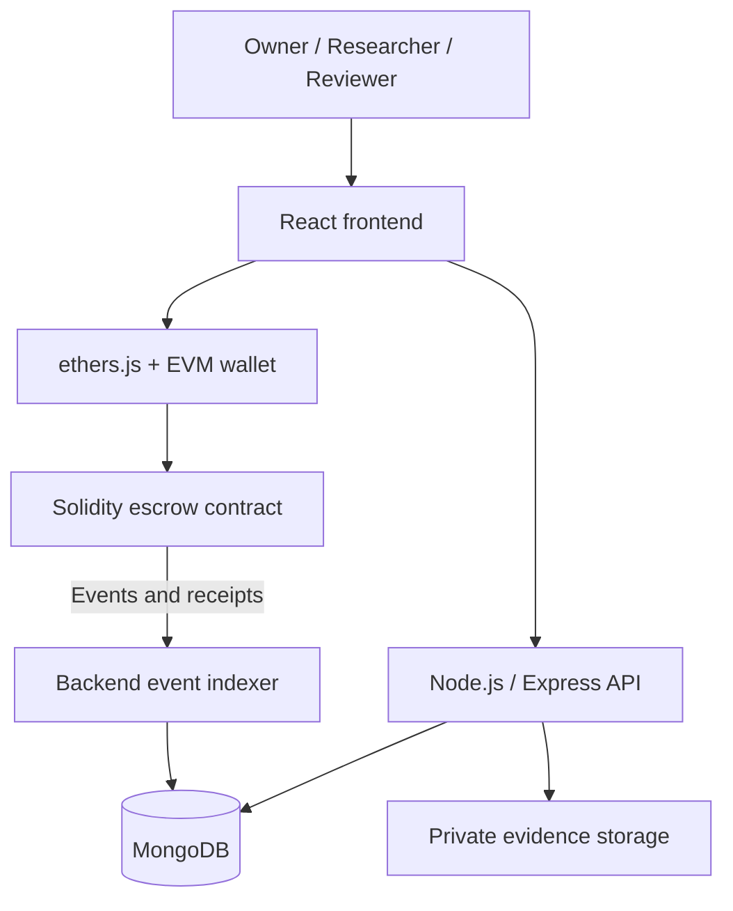

# Proofline

**A blockchain-powered bug bounty and private vulnerability disclosure platform.**

Proofline lets project owners fund security bounty campaigns, researchers submit vulnerability reports privately, and authorized reviewers evaluate findings. A Solidity escrow contract holds campaign funds and pays approved rewards to researchers' wallets exactly once.

This README is the central project overview, based on the [Proofline Product Requirements Document](doc/Proofline_PRD.pdf) (version 1.0, 30 October 2026).

## Project status

Proofline is currently in the planning stage. This repository contains the PRD and existing Solidity learning exercises under `solidity-basics/`; the Proofline application, escrow contract, and deployment workflow have not yet been implemented.

The project is an educational portfolio MVP using test ETH on a local Hardhat network and, later, Sepolia. Setup, run, test, and deployment commands will be documented as each component is implemented.

## Project overview

Security bounty programs need a structured way to define testing scope, receive confidential findings, review reports, and pay rewards. Proofline combines a conventional private application with blockchain escrow to make campaign funding and approved settlement auditable.

Human reviewers decide whether a vulnerability is valid. The smart contract enforces permissions, balances, reward rules, and payment state; it does not detect vulnerabilities or verify the truth of a report. Full reports and evidence remain off-chain.

The project aims to demonstrate:

- Practical Solidity development with a complete escrow and payout lifecycle.
- React integration with Ethereum through ethers.js and an EVM wallet.
- A JavaScript/TypeScript development workflow using Hardhat.
- Clear boundaries between public blockchain state and private application data.
- Meaningful tests, documented security assumptions, and a working testnet demo.

## Users and responsibilities

| Role | Responsibilities |
| --- | --- |
| Campaign owner | Define campaign scope and reward rules, deposit ETH, manage campaigns, authorize settlement under the selected permission model, and reclaim eligible unused funds. |
| Researcher | Browse campaigns, submit private findings and evidence, track review status, and receive approved rewards. |
| Reviewer | Read permitted reports, assess findings, add private notes, and approve or reject with a reason. |
| Administrator | Manage basic role assignments and reviewer access. |

The recommended first iteration uses the campaign owner as the only on-chain payout approver. Reviewer decisions can be recorded off-chain; a reviewer wallet allowlist can follow once the basic lifecycle works.

## End-to-end workflow

1. **Create and fund:** An owner publishes campaign scope, rules, deadline, and reward terms, then deposits ETH into escrow.
2. **Discover:** A researcher checks the campaign rules and contract-backed funding information.
3. **Submit privately:** The researcher sends a report, reproduction steps, suggested severity, and optional evidence through the authenticated backend.
4. **Review:** An authorized reviewer examines the report and records a decision with a reason.
5. **Settle:** An authorized wallet submits the payout transaction. The contract checks eligibility, balance, recipient, and previous settlement before paying.
6. **Confirm and track:** The application validates the confirmed receipt or contract event before displaying the report as paid.
7. **Close and refund:** The owner closes the campaign and withdraws only eligible unused funds, respecting outstanding approved rewards and the final refund rules.

For example, an owner could deposit **0.1 test ETH** into a campaign offering **0.02 test ETH** per qualifying report. After review and authorized settlement, the contract pays the approved researcher **0.02 test ETH** and records the payment event.

## MVP scope

- EVM wallet connection, address/network display, and unsupported-network blocking.
- Campaign creation, funding, discovery, and detail views.
- Private report submission with validated evidence uploads.
- Role-protected review, private notes, and approval/rejection reasons.
- Authorized, one-time ETH reward settlement.
- Campaign closure and safe refunds of eligible remaining funds.
- Owner, researcher, and reviewer dashboards.
- Activity history and clear wallet-confirmation, pending, confirmed, rejected, and failed transaction states.
- Basic administrator controls for roles and reviewer management.

Version 1 excludes multi-chain support, additional currencies, DAO governance, tokens, staking, NFT rewards, AI vulnerability detection, automated approval, public report disclosure, complex arbitration, subscriptions, fiat payments, mobile apps, and browser extensions.

## Architecture



| Layer | Planned technology | Purpose |
| --- | --- | --- |
| Frontend | React, TypeScript, Tailwind CSS | Dashboards, forms, campaign discovery, and transaction feedback. |
| Web3 client | ethers.js | Wallet interaction, contract reads, transactions, and events. |
| Smart contracts | Solidity; OpenZeppelin components where appropriate | Escrow accounting, authorization, settlement, and refunds. |
| Blockchain development | Hardhat | Local network, compilation, tests, and deployment scripts. |
| Backend | Node.js, Express | Authentication, authorization, validation, private reports, and event indexing. |
| Database | MongoDB, Mongoose | Application metadata, reports, reviews, and activity projections. |
| Evidence storage | Protected local storage initially; private S3-compatible storage later | Authorized access to attachments. |
| Networks | Hardhat local network, then Sepolia | Development and public testnet demonstration. |
| CI | GitHub Actions, recommended | Automated tests, linting, and build checks. |

### Sources of truth and privacy

| Data | Authoritative location |
| --- | --- |
| Campaign ownership, on-chain state, escrow balances, and settlement rules | Smart contract |
| Completed payouts and refunds | Confirmed blockchain transactions/events |
| Profiles, campaign descriptions, private reports, and reviewer notes | MongoDB |
| Screenshots, videos, and other evidence | Private file storage; metadata and storage keys in MongoDB |
| Optional report commitments and minimum required identifiers | Blockchain, if implemented |

All blockchain data is public. Report text, personal information, secrets, and evidence URLs must never appear in transaction input or events. A report commitment is a fingerprint, not encryption: if implemented, it must use a documented canonical format and a unique cryptographically secure random nonce.

The backend must reconcile indexed data with the chain and process repeated events idempotently. A client-side success message is insufficient evidence of payment.

## Smart-contract foundation

The proposed first contract, `BountyEscrow.sol`, will focus on campaign creation, ETH deposits, per-campaign accounting, authorized settlement, closure, refunds, and relevant events.

The PRD illustrates these lifecycle states; the final contract design must define their exact transitions:

- Campaign: `Active → Closed`.
- Submission: `Submitted → Approved → Paid`, or `Submitted → Rejected`.
- Refund: `Eligible → Refunded`.

Core invariants:

- Only authorized parties can manage campaigns or approve payouts.
- A submission can be paid at most once, to its bound researcher wallet.
- Rewards must follow stored campaign rules and available funding.
- Total payouts and refunds cannot exceed campaign deposits.
- Refunds cannot consume funds reserved for approved but unpaid rewards.
- Failed transfers and reentrancy attempts must not corrupt accounting.

## Security and reliability requirements

- Enforce backend authorization and contract permissions independently; never trust client-provided roles.
- Keep reports and evidence private, with permission checks for every read and download.
- Validate report fields and upload size, type, extension, and content.
- Never request or store users' seed phrases or wallet private keys.
- Keep deployment secrets and credentials out of Git; provide placeholder environment examples during implementation.
- Avoid logging report contents, credentials, tokens, or sensitive evidence.
- Recover transaction status from receipts/events after retries or browser closure.
- Use testnet funds only for this MVP.

## Implementation roadmap

| Phase | Focus | Completion criteria |
| --- | --- | --- |
| 0 | Project setup | Hardhat, frontend, API, and MongoDB start locally; compilation and health checks work. |
| 1 | Contract foundation | Campaign creation, funding, owner permissions, and events pass local tests. |
| 2 | Payout lifecycle | Settlement, duplicate prevention, insufficient funds, and closure/refund rules are tested. |
| 3 | Frontend Web3 | A user can connect a wallet, create/fund a campaign, and track confirmed transactions. |
| 4 | Backend and private reports | Authenticated researchers submit reports; permitted reviewers can retrieve them securely. |
| 5 | Review and settlement | Review decisions, on-chain payouts, event indexing, and history work end to end. |
| 6 | Hardening and demo | Security review, CI, documentation, Sepolia deployment, and a demo are complete. |

Start with the escrow contract interface, data structures, events, state transitions, and test cases. Build and test the deposit/payout core before integrating the frontend and private report system.

## Decisions to finalize before implementation

| Decision | PRD recommendation / status |
| --- | --- |
| Who authorizes on-chain payouts? | Start with owner-only approval; keep reviewer decisions off-chain initially. |
| Fixed rewards or severity tiers? | Start with one fixed reward per campaign. |
| Shared contract or separate escrows? | Use one contract with carefully tested per-campaign accounting. |
| When to add on-chain report commitments? | After the basic escrow and payout flow works. |
| Exact closure and refund conditions? | Still to be defined before implementing withdrawals, including deadlines and outstanding liabilities. |
| Application authentication and wallet binding? | Select the login approach; prove wallet ownership with a signed challenge where required. |

These are planning recommendations, not implemented behavior.

## Validation and success criteria

The MVP is complete when an owner can create and fund a campaign, a researcher can submit a private report, an authorized reviewer can decide it, and the approved researcher can receive exactly one confirmed payout.

Required validation includes:

- Contract tests for valid/invalid campaigns, funding, unauthorized actions, duplicate payouts, insufficient funds, deadline boundaries, refunds, failed transfers, and reentrancy attempts.
- Backend validation and authorization tests, including prevention of unauthorized report access.
- A successful frontend production build.
- One complete local or testnet demonstration from campaign creation through payout.
- Reproducible setup, run, test, and deployment instructions, plus architecture and security assumptions.

## Repository guide

Current contents:

```text
blockchain-learning/
├── README.md                  # Central Proofline overview
├── doc/
│   └── Proofline_PRD.pdf       # MVP requirements and implementation guidance
└── solidity-basics/           # Existing Solidity learning exercises
```

Planned application directories from the PRD include `contracts/`, `scripts/`, `test/`, `frontend/`, and `backend/`, with a root Hardhat configuration and package manifest. These will be added during implementation; further architecture, threat-model, and demo documentation can accompany the PRD in `doc/`.

For detailed functional requirements, suggested database collections and API routes, screen requirements, and acceptance criteria, see the [full PRD](doc/Proofline_PRD.pdf).
