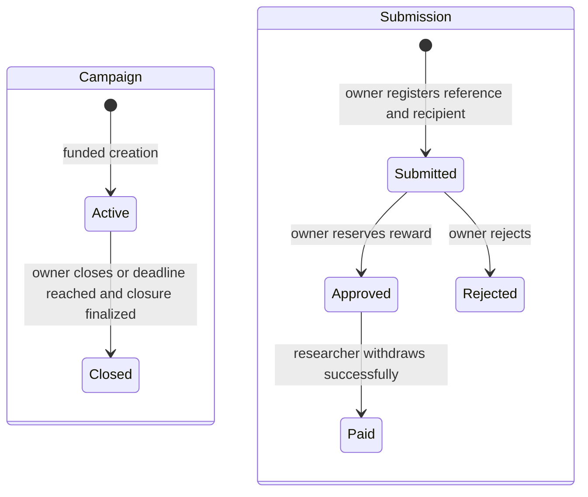

# Proofline smart-contract construction guide

This is a learning guide for constructing `BountyEscrow.sol` yourself. It contains design guidance, exercises, and acceptance checks; it does not implement the contract or run setup/deployment commands.

Read it alongside the [Proofline PRD](Proofline_PRD.pdf). The PRD leaves some contract choices open. The model below is a proposed coherent first design, not an already implemented specification. Write down your final choices before coding.

## 1. Understand the contract's job

The contract holds ETH for campaigns, checks who can authorize rewards, and prevents funds from being spent twice. Human reviewers decide whether reports are valid.

Keep these responsibilities outside Solidity:

- Report descriptions, reproduction steps, severity explanations, and reviewer notes.
- Login, user profiles, evidence uploads, and download authorization.
- Campaign descriptions, asset scope, search, notifications, and dashboards.

Store these in the contract:

- Campaign identity, owner, fixed reward, deadline, and lifecycle state.
- Campaign deposits, available funds, reserved rewards, payouts, and refunds.
- Minimal submission references, bound researcher addresses, and settlement state.
- Events needed to reconstruct financial activity.

All storage and transaction input are public, including variables marked `private`. Never send confidential report details to the contract. See [Solidity security considerations](https://docs.soliditylang.org/en/latest/security-considerations.html).

**Exercise:** Explain in your own words why the contract can prevent duplicate payment but cannot prove a vulnerability exists.

## 2. Choose one simple financial model

Use these proposed rules for your first complete version:

| Topic | Proposed rule |
| --- | --- |
| Currency | Native ETH, represented in wei. |
| Deployment | One non-upgradeable contract with accounting isolated by campaign. |
| Campaign creation | Any wallet may create a campaign and becomes that campaign's owner. |
| Reward | One fixed, positive amount per campaign, immutable after creation. |
| Initial funding | Creation includes at least one reward's worth of ETH. |
| Further funding | Only the campaign owner, while the campaign accepts new activity. |
| Reviewer authority | Review happens off-chain; only the campaign owner authorizes on-chain approval or rejection. |
| Settlement | Approval reserves funds; the bound researcher later withdraws their individual reward. |
| Submission reference | An opaque, nonzero `bytes32` reference scoped to a campaign. |
| Report commitments | Optional later addition; not needed to test escrow accounting. |
| Closure | Owner may close early; anyone may finalize closure at or after the deadline. Closure is permanent. |
| Refund | Owner only, after closure, with no pending registered submissions or unpaid approved rewards. |

This withdrawal model adds an `Approved` state between review and payment. Approval does not itself transfer ETH. The UI must distinguish “Approved, ready to withdraw” from “Paid.”

With this design, the owner registers a report reference and its researcher wallet before the submission deadline. Registration binds the wallet permanently. This trusts the owner to register the correct reference and recipient; the contract cannot verify the database record. The application must verify wallet ownership and match the registration against the authenticated report. Researcher-signed registration or direct researcher registration would require a separate design.

**Scope limitation:** A private backend upload is not an on-chain registration. A report left unregistered before closure has no contract-enforced claim. This is an owner-mediated learning MVP, not trustless adjudication.

**Checkpoint:** Be able to describe who registers, who approves, who withdraws, and when funds become reserved.

## 3. Prepare your workspace deliberately

Your repository currently separates `blockchain/`, `client/`, `server/`, and `documentation/`. An existing Hardhat project is under `blockchain/y/`. Inspect its configuration and package manifest before deciding whether to reuse it or create a dedicated Proofline workspace.

Do not mix tutorial contracts into the application without reviewing them. Keep tutorial exercises available while giving Proofline its own contract and test files.

Your eventual contract workspace should provide:

- `contracts/BountyEscrow.sol` for the application contract.
- A dedicated contract test file or suite.
- Test-only receiver contracts for failed-transfer and reentrancy scenarios.
- A deployment module/script appropriate to your installed Hardhat version.
- Pinned compiler configuration, a dependency lockfile, and ignored secret files.

Use the [Hardhat documentation](https://hardhat.org/docs/getting-started) matching your installed major version. Choose compatible Solidity and OpenZeppelin versions; avoid copying configuration from a different Hardhat major version.

**Done when:** The existing workspace compiles and its baseline tests run before you add Proofline behavior. This guide does not execute those checks for you.

## 4. Define the data model on paper

### Campaign

| Field | Purpose |
| --- | --- |
| `owner` | Wallet authorized to fund, register, decide, and refund this campaign. |
| `rewardAmount` | Fixed reward in wei. |
| `deadline` | Unix timestamp after which new funding and registrations are blocked. |
| `state` | Explicit nonexistent, active, or closed state. |
| `availableFunds` | Deposited ETH not reserved, paid, or refunded. |
| `reservedFunds` | ETH promised to approved submissions and not yet withdrawn. |
| `totalDeposited` | Cumulative funding received through campaign functions. |
| `totalPaid` | Cumulative successful researcher withdrawals. |
| `totalRefunded` | Cumulative successful owner refunds. |
| `pendingSubmissionCount` | Registered submissions awaiting an owner decision. |

Some accounting totals are redundant but useful for learning and verification. If you store them, update them consistently on every relevant path.

Use campaign IDs starting at 1 and explicitly reject nonexistent campaigns. Do not let the default values of an empty mapping entry behave like a real campaign.

### Submission

| Field | Purpose |
| --- | --- |
| `researcher` | Nonzero, immutable recipient wallet bound at registration. |
| `state` | None, submitted, approved, rejected, or paid. |

Index submissions by both campaign ID and opaque reference. A reference may occur in different campaigns, but cannot be reused within the same campaign. A database ID alone does not establish on-chain identity.

Since rewards are immutable per campaign, the amount can be derived from the campaign. If you later support variable rewards, record each approved amount and redesign the related invariants.

Use mappings and constant-time counters. Avoid storing every report in an array that must be looped through during refunds.

## 5. Draw the lifecycle before writing functions



Time passing does not execute a transaction or automatically change a stored enum. Every function accepting new activity must check both the stored state and timestamp.

Apply exact boundaries:

- New funding and registration require `Active` and `block.timestamp < deadline`.
- Creation requires `deadline > block.timestamp`.
- At exactly the deadline, new funding and registration fail.
- Existing registered submissions may be approved or rejected after deadline/closure.
- Approved rewards remain withdrawable after deadline/closure.
- Rejected and paid submissions have no outgoing transitions in version 1.
- Refund requires stored `Closed`, zero pending submissions, and zero reserved funds.

Requiring pending decisions before refund prevents the owner from refunding while a registered report is awaiting review. Requiring zero reserves is deliberately stricter than refunding only unreserved funds: unpaid approvals block the whole refund. A researcher who never withdraws can therefore delay the owner's refund indefinitely. Document this tradeoff; do not add a silent expiry that takes away approved rewards.

## 6. Write the interface as function descriptions

These are proposed names and behaviors, not Solidity implementations.

| Function | Caller | Inputs | Outcome |
| --- | --- | --- | --- |
| `createCampaign` | Any wallet | Reward, deadline, attached ETH | Creates funded campaign and returns its ID. |
| `fundCampaign` | Campaign owner | Campaign ID, attached ETH | Adds positive funding to an active, unexpired campaign. |
| `registerSubmission` | Campaign owner | Campaign ID, reference, researcher | Binds a fresh reference to a recipient; increases pending count. |
| `approveSubmission` | Campaign owner | Campaign ID, reference | Reserves exactly one reward and changes submitted to approved. |
| `rejectSubmission` | Campaign owner | Campaign ID, reference | Changes submitted to rejected and decreases pending count. |
| `withdrawReward` | Bound researcher | Campaign ID, reference | Transfers the approved reward and changes approved to paid. |
| `closeCampaign` | Owner early; anyone after expiry | Campaign ID | Permanently closes an active campaign. |
| `refundUnusedFunds` | Campaign owner | Campaign ID | Refunds positive available funds once all refund conditions hold. |
| `getCampaign` | Anyone | Campaign ID | Returns public campaign state and accounting. |
| `getSubmission` | Anyone | Campaign ID, reference | Returns public recipient and settlement state. |

For each function, first write its checks, state changes, event, and whether it calls an external address.

Keep decision reasons and evidence in the backend. Solidity permissions are based on the caller's wallet and the stored campaign owner, independent of application login or database roles. Global contract ownership is not a substitute for per-campaign ownership.

## 7. Work through the accounting

For every campaign, require this identity after every successful transaction:

```text
totalDeposited = availableFunds + reservedFunds + totalPaid + totalRefunded
```

| Action | Accounting change |
| --- | --- |
| Create/fund with D wei | Deposited +D; available +D. |
| Register report | Pending count +1; no financial change. |
| Approve reward R | Available -R; reserved +R; pending count -1. |
| Reject report | Pending count -1; no financial change. |
| Withdraw reward R | Reserved -R; paid +R; mark paid before external call. |
| Refund amount F | Available -F; refunded +F; update before external call. |

Approval must check available funds before reserving. Two separate reports cannot reserve the same money.

Example in test ETH: deposit 0.10; approve a 0.02 reward; available becomes 0.08 and reserved 0.02. After withdrawal, available remains 0.08, reserved becomes zero, and paid becomes 0.02. After closure and final decisions, refund 0.08. The final totals are deposits 0.10, payouts 0.02, refunds 0.08.

Across campaigns, the sum of available and reserved funds must never exceed the actual contract ETH balance. It may be smaller if unsolicited ETH is forced into the contract. Do not use the whole contract balance as any individual campaign's withdrawable amount.

Reject ordinary direct ETH transfers without a campaign reference. Forced ETH can still arrive; exclude it from campaign accounting and defer any surplus-recovery feature.

**Exercise:** Repeat the example with two campaigns and prove that approving a report in campaign A cannot spend campaign B's funds.

## 8. Design external transfers safely

For researcher withdrawals and owner refunds:

1. Check existence, caller, lifecycle state, and financial eligibility.
2. Update status and accounting before calling the recipient.
3. Make the ETH transfer using an appropriate checked call.
4. Revert the entire transaction if the transfer fails.
5. Emit the success event only on the successful path.

On failure, a revert restores the earlier state changes too. A failed withdrawal must leave the reward approved and reserved, so the researcher can retry.

Follow [Solidity's checks-effects-interactions guidance](https://docs.soliditylang.org/en/latest/security-considerations.html) and use an established [OpenZeppelin ReentrancyGuard](https://docs.openzeppelin.com/contracts/5.x/api/utils#ReentrancyGuard) compatible with your dependencies. Review all externally callable mutation paths for reentrancy, including calls into a different function.

The pull-payment rationale is described in [Solidity's withdrawal pattern](https://docs.soliditylang.org/en/latest/common-patterns.html#withdrawal-from-contracts). Here, each approved submission has its own withdrawal instead of a shared wallet credit balance.

A researcher contract that always refuses ETH cannot collect under this fixed-recipient design. An owner contract that refuses ETH similarly cannot receive refunds. These failures must affect that transfer, not corrupt other campaigns. Recipient changes or alternative destinations need a separate authorization design; defer them.

## 9. Plan events and custom errors

Suggested public events:

| Event | Useful public fields |
| --- | --- |
| `CampaignCreated` | Campaign ID, owner, fixed reward, deadline, initial deposit. |
| `CampaignFunded` | Campaign ID, funder, amount. |
| `SubmissionRegistered` | Campaign ID, opaque reference, researcher. |
| `SubmissionApproved` | Campaign ID, reference, authorizer, reserved amount. |
| `SubmissionRejected` | Campaign ID, reference, authorizer. |
| `RewardPaid` | Campaign ID, reference, researcher, amount. |
| `CampaignClosed` | Campaign ID, caller. |
| `CampaignRefunded` | Campaign ID, recipient, amount. |

Index identifiers commonly used by the backend. Never include private report content or rejection explanations. Registration links a wallet to a campaign publicly even without report text; explain that privacy boundary to users.

Define custom errors for missing campaigns/submissions, unauthorized callers, invalid reward/deadline/deposit, closed or expired campaigns, duplicate references, invalid transitions, insufficient available funds, pending decisions, outstanding reserves, empty refunds, and failed transfers. Use errors that let tests and the UI distinguish causes.

## 10. Construct incrementally, with tests

For each stage, write its expected behavior first, implement only that stage, and run the relevant tests before continuing.

| Stage | Construction task | Required checks |
| --- | --- | --- |
| A | Types, mappings, IDs, errors, and read methods | Missing IDs fail clearly; default mapping states cannot act as real records. |
| B | Campaign creation | Valid event and fields; reject zero reward, past/current deadline, and deposit below reward. |
| C | Additional funding | Correct accounting; reject zero value, wrong owner, expiry, and closure. |
| D | Registration | Bind recipient; reject zero recipient/reference, duplicate, wrong owner, expiry, and closure. |
| E | Approval/rejection | Owner only; submitted state only; exact reservation; correct pending count. |
| F | Researcher withdrawal | Bound caller only; approved state only; correct payment and event; duplicate blocked. |
| G | Closure/refund | Permission/deadline boundaries; no reopening; reject pending reports, reserves, and empty refund. |
| H | Adversarial tests | Failed transfers, reentrancy, isolated campaign balances, and invariant checks. |

Use separate signers for two owners, two researchers, and an unrelated attacker. Include these meaningful scenarios:

- Owner A cannot decide, fund, close early, or refund owner B's campaign.
- A rejected report cannot be approved or paid; a paid report cannot be paid again.
- An unknown or unapproved reference cannot be withdrawn.
- With only one reward available, approving a second report fails without changing accounting.
- Approval after closure works for a previously registered submission; registration after closure fails.
- Before, exactly at, and after deadline cases behave as specified, using controlled chain time.
- Closing with pending submissions does not delete them; they can still be decided.
- Refund fails before closure, while pending decisions exist, and while approved rewards remain unpaid.
- A successful refund cannot be repeated without new eligible funds; closed campaigns cannot be funded again.
- A refusing receiver leaves its withdrawal/refund retryable and accounting unchanged.
- A malicious receiver cannot obtain extra funds through same-function or cross-function reentry.
- A sequence involving two campaigns preserves both individual accounting identities and overall solvency.

Check recipient balances with gas costs accounted for when the recipient is also the transaction sender. Check contract balance changes, state changes, errors, and events rather than relying on one balance assertion.

**Checkpoint:** You can explain each test's purpose without reading the implementation.

## 11. Connect a manual local demonstration

Only after the contract tests pass, perform this sequence on your local development chain:

1. Deploy the escrow contract and record its chain ID and address.
2. Owner creates a campaign with a fixed reward and deposit.
3. Owner registers an opaque reference bound to the researcher's wallet.
4. Owner approves it; inspect the reserved balance.
5. Researcher withdraws; inspect the payout event and submission state.
6. Try withdrawing again and verify rejection.
7. Close the campaign and refund the eligible remainder.
8. Verify the final accounting identity.

Keep the deployment artifact and ABI available for your client and server. Treat the combination of chain ID, contract address, and campaign ID as a campaign's blockchain identity.

## 12. Integrate with the application

The React client should connect the appropriate wallet, validate the network, read contract state, and prepare transactions. The Express server should authenticate users, verify wallet ownership where required, protect report access, and link backend reports to on-chain references.

Suggested integration sequence:

1. Client creates/funds a campaign; server associates confirmed campaign ID with private/application metadata.
2. Researcher uploads a private report through the backend.
3. Owner checks and registers the correct reference and researcher wallet before closure/deadline.
4. Reviewer records a private decision; owner independently authorizes the on-chain decision.
5. On-chain approval makes the reward withdrawable; the researcher submits withdrawal.
6. Backend validates the receipt/event from the configured contract and updates its projection.

Verify receipt success, expected network/address, event identity, campaign, reference, recipient, and amount. Never mark a report paid from a client-provided message or an approval event alone.

Make event ingestion idempotent, retain enough block/log information to handle reorganizations, and choose a confirmation policy before the testnet demo. Recover pending transaction status after browser closure. Read the chain again when database projections disagree.

## 13. Add commitments only after the core works

An opaque submission reference identifies a record; it is not automatically a commitment to report content.

For a later commitment feature, define a versioned canonical serialization of the report, generate a secure random nonce, and commit to the canonical content plus nonce with an established hash function. Define attachment digests if attachments are covered. Preserve the original canonical version, not just an editable current report.

Keep the nonce and original content protected off-chain. Specify how an authorized verifier can later reproduce the commitment. A hash provides neither encryption nor evidence that a finding is valid, and it does not stop an owner from refusing payment.

## 14. Review before a Sepolia deployment

- Explain every permission, state transition, and accounting update.
- Run the contract suite and review failed-transfer and reentrancy behavior.
- Review compilation warnings and use suitable static analysis as an additional check.
- Confirm no endpoint or global administrator can bypass campaign accounting.
- Document owner-mediated registration, human review trust, early closure, refund blocking, and fixed-recipient limitations.
- Pin compatible toolchain/dependency versions and preserve the lockfile.
- Keep secrets out of Git and never reuse publicly known local development keys on public networks.
- Prepare a testnet deployment artifact, source verification where supported, and a short end-to-end demo.

This remains a learning MVP using test funds. Testing and automated analysis do not constitute a security audit.

## Your first work session

Before implementing any function, write your chosen policy for each row in section 2, sketch the campaign/submission fields, and describe the checks and accounting for `createCampaign` and `fundCampaign`.

Then implement and test only those two functions. Continue through section 10 in order. Each stage should leave you with understandable behavior and tests that demonstrate it.
